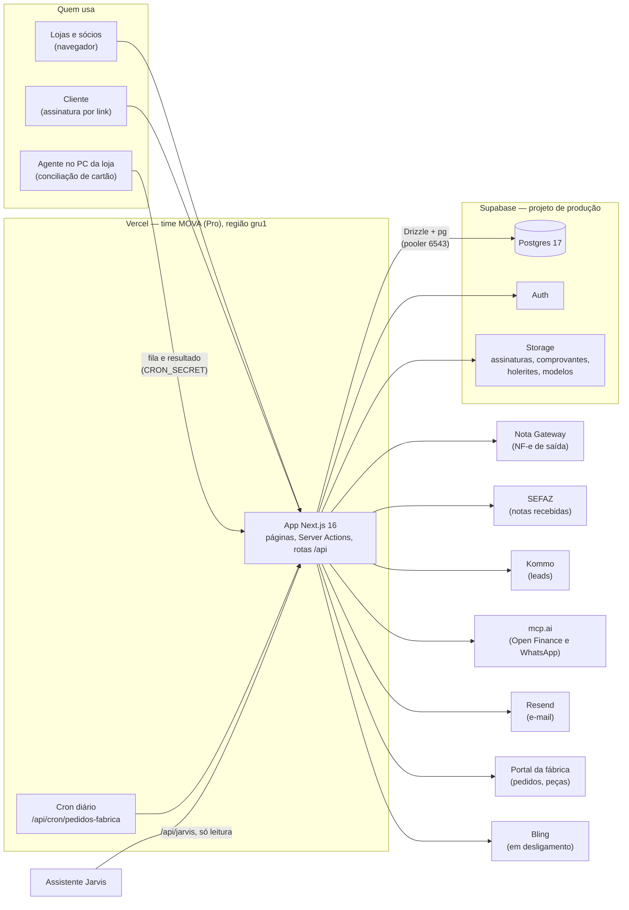

# Arquitetura do MOVA

Visão de uma página: as peças do sistema, com quem ele conversa e por onde o código chega à
produção. Vocabulário do negócio em [`CONTEXT.md`](../CONTEXT.md); decisões e porquês em
[`adr/`](adr/README.md). Levantado do código da `dev` em 2026-10-06.

## Visão geral

## Peças

**App (Next.js na Vercel).** Um só projeto, `mova-motochefe`, com páginas renderizadas no
servidor, Server Actions para as escritas e rotas `/api/*` para integrações e chamadas de
fora. Roda no Fluid Compute da Vercel, região `gru1` (`vercel.json`).

- O `middleware.ts` valida a sessão antes de toda página logada, conferindo o JWT localmente
  (sem ida ao servidor de Auth).
- Ficam fora do login: `/assinar` (o cliente entra com o token do link) e `/convencao` (landing
  de captação de lead).

**Banco (Supabase Postgres).**
- O app acessa por **Drizzle** sobre o driver `pg`, com `attachDatabasePool`, pelo pooler
  Supavisor em transaction mode (porta 6543) ([ADR 0009](adr/0009-driver-pg-com-attach-database-pool.md)).
- Algumas operações de estoque e venda rodam como funções no próprio banco (RPCs `SECURITY
  DEFINER`), chamadas pelo cliente Supabase.
- O isolamento entre grupos é feito pelas consultas do app ([ADR 0007](adr/0007-multi-tenant-por-cnpj.md)).
  O RLS do banco ainda não separa por grupo (issue #16).

**Auth e Storage (Supabase).** O login é do Supabase Auth. Os arquivos ficam em quatro buckets
(`assinaturas`, `comprovantes`, `holerites`, `modelos`), que **não entram no backup do banco**
([`infra/backup-restore.md`](infra/backup-restore.md)).

## Integrações

| Serviço | Para quê | Direção | Credencial | Onde no código |
|---|---|---|---|---|
| Nota Gateway | Emitir NF-e de saída (homologação ou produção, por grupo) | app → serviço | por grupo, no banco, cifrada | `src/lib/notagateway/` |
| SEFAZ | Ler NF-e emitidas contra o CNPJ (notas recebidas), sob demanda na tela | app → SEFAZ, com certificado A1 | certificado A1 por grupo, cifrado | `src/lib/sefaz/` |
| Kommo | Leads, atividade e funis para Atendimento e Marketing; o sync roda ao abrir a tela (cache de 15 min) | app → Kommo (OAuth) | no banco | `src/lib/kommo.ts`, `/api/kommo/*` |
| mcp.ai | PIX recebidos e despesas via Open Finance; envio de WhatsApp (avisos) | app → serviço | endpoint por grupo, no banco (fallback em env) | `src/lib/mcpai*.ts`, `src/lib/whatsapp/` |
| Resend | E-mail (contrato, códigos de assinatura, leads) e webhook de status | app ↔ serviço | env (`RESEND_*`) | `src/lib/email.ts`, `/api/webhooks/resend` |
| Portal da fábrica | Pedidos de peças e alertas de pedido aguardando pagamento (leitura do portal com login por loja) | app → portal | por loja, no banco | `src/lib/fabrica-scraper.ts`, `src/lib/fabrica-por-loja.ts` |
| Operadoras de cartão (Stone, PagueVeloz, InfinitePay) | Importar vendas de cartão para a conciliação | agente no PC da loja → operadora → app | no PC da loja | `scripts/conciliacao/`, `/api/conciliacao/*` |
| Bling | ERP antigo, ainda em convivência e a ser desligado | app → Bling (OAuth) | por grupo, no banco | `src/lib/bling.ts`, `/api/bling/*` |
| Jarvis | Assistente que consulta o MOVA (só leitura) | Jarvis → app | `JARVIS_API_TOKEN` | `/api/jarvis/*`, `src/lib/jarvis/` |

Regra para integração nova: credencial por grupo, no banco, cifrada
([ADR 0010](adr/0010-credencial-de-integracao-no-banco-cifrada.md)).

## O que roda sozinho

- **Cron da Vercel**, diário às 12h UTC (9h de Brasília): `/api/cron/pedidos-fabrica` lê o
  portal da fábrica de cada loja e avisa no WhatsApp os pedidos aguardando pagamento.
- **Agente de conciliação**, no PC da loja: pergunta à fila (`/api/conciliacao/fila`) se há
  pedido de importação, entra nos painéis das operadoras e devolve as vendas
  (`/api/conciliacao/cartao`).
- **Sincronizações sob demanda**, disparadas por quem abre a tela: Kommo (Atendimento e
  Marketing, cache de 15 min), notas recebidas da SEFAZ (botão na tela) e saldos e PIX do Open
  Finance.

## Ambientes

| | Produção | Staging | Local |
|---|---|---|---|
| App | Vercel, time MOVA, branch `main` | Preview da Vercel (fase 6, ainda sem variáveis do staging) | `npm run dev:staging` |
| Banco | Supabase "Estoque Chassi" | Supabase `mova-staging`, só dado sintético ([ADR 0005](adr/0005-zero-dado-real-fora-de-producao.md)) | o do staging |
| Detalhes | [`infra/backup-restore.md`](infra/backup-restore.md) | [`infra/staging.md`](infra/staging.md) | [`infra/segredos.md`](infra/segredos.md) |

O `.env.local` ainda aponta para a produção (D5 pendente; ver `AGENTS.md`).

## Do código à produção

1. Branch a partir de `dev` → PR para `dev` → CI (`type-check`, `test`, `build`, `gitleaks`) e
   revisão ([ADR 0002](adr/0002-branches-dev-main-e-revisao.md),
   [ADR 0003](adr/0003-ci-como-portao-vercel-como-entrega.md)).
2. Merge com squash na `dev`. A Vercel gera preview de cada PR.
3. PR `dev → main` com merge commit. O push na `main` publica em produção, automático.
4. Migração de banco não vai com o deploy: é aplicada à parte, pelo `scripts/migrate.ts`, primeiro
   no staging e depois na produção ([ADR 0004](adr/0004-migracoes-versionadas.md)).
