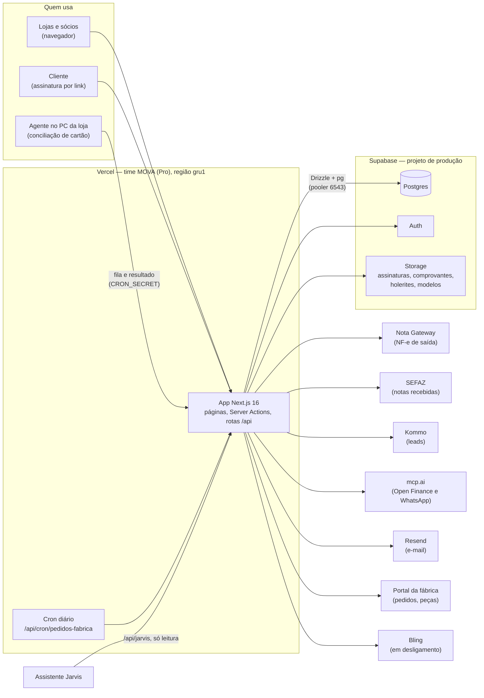

# Arquitetura do MOVA

Visão de uma página: as peças do sistema, com quem ele conversa e por onde o código chega à
produção. Vocabulário do negócio em [`CONTEXT.md`](../CONTEXT.md); decisões e porquês em
[`adr/`](adr/README.md). Levantado do código da `dev` em 2026-10-06.

## Visão geral

## Peças

**App (Next.js na Vercel).** Um só projeto, `mova-motochefe`, com páginas renderizadas no
servidor, Server Actions para as escritas e rotas `/api/*` para integrações e chamadas de
fora. Roda no Fluid Compute da Vercel, na região `gru1` (`vercel.json`).

- O `middleware.ts` valida a sessão antes de cada página logada. Na maioria das requisições,
  confere o JWT localmente; só vai ao servidor de Auth para renovar o token.
- Ficam fora do middleware:
  - `/assinar` (o cliente entra com o token do link);
  - `/convencao` (landing de captação de lead);
  - **todas as rotas `/api/*`**, e cada uma se autentica sozinha: `CRON_SECRET` (cron e
    conciliação), `JARVIS_API_TOKEN`, assinatura do webhook do Resend ou usuário logado (DANFE,
    XML, relatório contábil).
- `/api/health` é pública e só testa o banco.

**Banco (Supabase Postgres).**
- O app acessa por **Drizzle** sobre o driver `pg`, com `attachDatabasePool`, pelo pooler
  Supavisor em transaction mode (porta 6543) ([ADR 0009](adr/0009-driver-pg-com-attach-database-pool.md)).
  O Jarvis usa um segundo pool pequeno, com `postgres.js`.
- Algumas operações rodam como funções no próprio banco (RPCs `SECURITY DEFINER`), chamadas pelo
  cliente Supabase: mudança de status de moto, pedido de venda, transferência e garantia.
- O isolamento entre grupos é feito pelas consultas do app ([ADR 0007](adr/0007-multi-tenant-por-cnpj.md)).
  O RLS do banco ainda não separa por grupo (issue #16).

**Auth e Storage (Supabase).** O login é do Supabase Auth. Os arquivos ficam em quatro buckets
(`assinaturas`, `comprovantes`, `holerites`, `modelos`), que **não entram no backup do banco**
([`infra/backup-restore.md`](infra/backup-restore.md)).

## Integrações

| Serviço | Para quê | Direção | Credencial | Onde no código |
|---|---|---|---|---|
| Nota Gateway | Emitir NF-e de saída (homologação ou produção, por grupo) | app → serviço | por grupo, no banco, cifrada | `src/lib/notagateway/` |
| SEFAZ | Ler NF-e emitidas contra o CNPJ (notas recebidas), pelo botão da tela | app → SEFAZ, com certificado A1 | certificado A1 por grupo, cifrado | `src/lib/sefaz/` |
| mcp.ai (Open Finance) | PIX recebidos, despesas, saldos e faturas das contas do grupo | app → serviço | endpoint por grupo, no banco, cifrado (fallback em env) | `src/lib/mcpai*.ts` |
| mcp.ai (WhatsApp) | Avisos de venda e de pedidos da fábrica | app → serviço | **env global** (`MCPAI_WHATSAPP_URL`, `WHATSAPP_ALERTA_NUMERO`) | `src/lib/whatsapp/` |
| Kommo | Leads, atividade e funis para Atendimento e Marketing | app → Kommo (OAuth ou token de longa duração) | **uma conexão global**, no banco, sem cifra | `src/lib/kommo.ts`, `/api/kommo/*` |
| Resend | E-mail (contrato e códigos de assinatura, leads da convenção) e webhook de status | app ↔ serviço | env (`RESEND_API_KEY`, `EMAIL_FROM`, `RESEND_WEBHOOK_SECRET`) | `src/lib/email.ts`, `/api/webhooks/resend` |
| Portal da fábrica | Pedidos de peças, pedidos aguardando pagamento e garantias (leitura do portal com login por loja) | app → portal | por loja, no banco, sem cifra | `src/lib/fabrica-scraper.ts`, `src/lib/fabrica-por-loja.ts` |
| Operadoras de cartão (Stone, PagueVeloz, InfinitePay) | Importar vendas de cartão para a conciliação | agente no PC da loja → operadora → app | sessão do navegador no PC da loja | `scripts/conciliacao/`, `/api/conciliacao/*` |
| Bling | ERP antigo, ainda em convivência e a ser desligado | app → Bling (OAuth) | por grupo, no banco, sem cifra | `src/lib/bling.ts`, `/api/bling/*` |
| Jarvis | Assistente que responde perguntas sobre o negócio consultando o MOVA | Jarvis → app | `JARVIS_API_TOKEN` | `/api/jarvis/*`, `src/lib/jarvis/` |

Três integrações fogem do [ADR 0010](adr/0010-credencial-de-integracao-no-banco-cifrada.md)
(credencial por grupo, no banco, cifrada):
- o WhatsApp usa env global;
- o Kommo tem uma conexão só para todos os grupos;
- Bling e fábrica não cifram.

**Telegram:** o bot e os avisos por Telegram foram aposentados em 2026-08-10 (`952c29a`), e os
avisos passaram para o WhatsApp. Sobraram restos: o agente de conciliação ainda avisa por
Telegram (`scripts/conciliacao/navegador.ts`), a coluna `grupos.telegram_chat_id` e as variáveis
`TELEGRAM_*` ([`infra/segredos.md`](infra/segredos.md)).

**Riscos conhecidos:**
- desde 2026-09-01, o portal da fábrica pode exigir uma verificação anti-robô que só o
  navegador resolve (`fabrica-scraper.ts`). Em 2026-10-06 a leitura funcionava para as 5 lojas
  com credencial; acompanhamento na issue #24;
- o Jarvis roda `SELECT` livre, só leitura e sem filtro de grupo (`src/lib/jarvis/consulta-readonly.ts`).

## O que roda sozinho

- **Cron da Vercel**, diário às 12h UTC (9h de Brasília): `/api/cron/pedidos-fabrica` lê o
  portal da fábrica de cada loja, grava os pedidos aguardando pagamento e avisa no WhatsApp. O
  botão "Atualizar" do dashboard faz a mesma leitura, sem avisar.
- **Agente de conciliação**, no PC da loja: pergunta à fila (`/api/conciliacao/fila`) se há
  pedido de importação, entra nos painéis das operadoras com a sessão do navegador e devolve as
  vendas (`/api/conciliacao/cartao`). Ele lê o `.env.local` da máquina.
- **Sincronizações sob demanda**, disparadas por quem abre a tela:
  - Kommo (Atendimento e Marketing, cache de 15 min);
  - PIX e despesas do Open Finance (cache de 10 min; saldos e faturas sempre ao vivo);
  - notas recebidas da SEFAZ (botão na tela).

## Ambientes

| | Produção | Staging | Local |
|---|---|---|---|
| App | Vercel, time MOVA, branch `main` | ainda não há app de staging na Vercel: o Preview usa segredos de integração da produção e não tem banco (fase 6) | `npm run dev` (ou `dev:staging`) |
| Banco | Supabase "Estoque Chassi" | Supabase `mova-staging`, só dado sintético ([ADR 0005](adr/0005-zero-dado-real-fora-de-producao.md)) | o do staging |
| Detalhes | [`infra/backup-restore.md`](infra/backup-restore.md) | [`infra/staging.md`](infra/staging.md) | [`infra/segredos.md`](infra/segredos.md) |

Local: o `.env.local` é o staging, e a produção só existe em `.env.production.local`, usada de
forma explícita ([`infra/segredos.md`](infra/segredos.md)).

## Do código à produção

1. Branch a partir de `dev` → PR para `dev` → CI (`type-check`, `test`, `build`, `gitleaks`,
   mais `knip` e `npm audit` como aviso) e revisão
   ([ADR 0002](adr/0002-branches-dev-main-e-revisao.md),
   [ADR 0003](adr/0003-ci-como-portao-vercel-como-entrega.md)). Hoje isso é combinado, não
   imposto: os rulesets do GitHub (fase 8) ainda não existem.
2. Merge com squash na `dev`. A Vercel gera preview de cada PR.
3. PR `dev → main` com merge commit. O push na `main` publica em produção, automático.
4. Hotfix: nasce da `main`, PR para `main`, depois PR `main → dev`.
5. Migração de banco não vai com o deploy: é aplicada à parte, pelo `scripts/migrate.ts`, primeiro
   no staging e depois na produção ([ADR 0004](adr/0004-migracoes-versionadas.md)).
